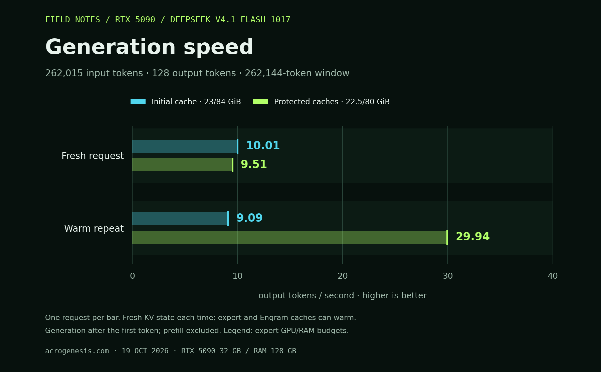
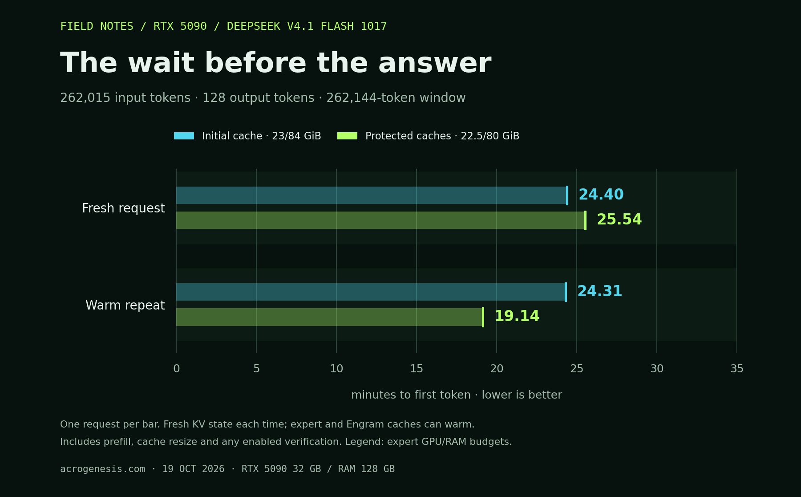

# 256K context on an RTX 5090

**29.94 output tokens/s on the repeated request, with 262,015 actual input
tokens and 128 output tokens inside a 262,144-token window.** The fresh request
measured 9.51 tok/s. Each request starts with fresh KV/recurrent state; only
expert and Engram caches remain warm. This retains the earlier approximately
30 tok/s repeated-request rate at a filled 256K context.

Hardware: RTX 5090 32 GB, Ryzen 9950X3D, 128 GB RAM and Samsung 990 PRO NVMe.
Weights: the original LibertAIDAI EXL3 2.9 bpw checkpoint and original DeepSeek
1017 Engram tables, pinned in `models.lock.json`. Weight and KV precision are
unchanged. The KV pools occupy 800 MiB at 256K.

## Measurements



| Full-window configuration | Fresh tok/s | Repeat tok/s | Fresh / repeat time to first token |
|---|---:|---:|---:|
| Initial elastic cache, 23 GiB GPU / 84 GiB RAM | 10.01 | 9.09 | 1,463.82 / 1,458.79 s |
| Protected caches, 22.5 GiB GPU / 80 GiB RAM | **9.51** | **29.94** | 1,532.29 / 1,148.59 s |



Both configurations prefill with an 18 GiB expert GPU arena, then expand it
before generation. Both consume the same 262,015-token fixture and finish at
KV position 262,142. Throughput is delivered tokens after the first token divided
by elapsed time after that token. These are one fresh and one repeated request
per configuration, each producing 128 tokens; they are not confidence intervals.

Expert disk reads during repeated generation fell from **26.85 GB to zero**.
The final repeat also had **12,192 Engram row hits and zero misses**. Its observed
generation working set was 6,069 experts / 77.61 GB; the GPU hit rate was 73.37%.
The remaining experts are still available on demand.

The final model used no swap. The external 30-second samples recorded no cgroup
OOM events and at least 15.77 GB of available host RAM. Sampling began during
fresh prefill; it does not establish a continuous minimum. Both processes exited
successfully and the GPU returned to desktop use.

## Why the repeat stays fast

- The bounded paged indexer avoids the large query-by-head-by-history temporary.
  It retains native projections, RoPE, causal visibility, candidate blocks and
  top-k sizes, with FP32 score accumulation and FP16 query/key values.
- Generation accesses train GPU and RAM cache priority. Prefill scans do not
  displace previously useful experts merely by reading every expert.
- Resizing preserves the hottest resident expert bytes within the new quotas.
  Migration reads do not count as model accesses.
- Up to half the existing 65,536-entry Engram row budget protects rows observed
  during generation. Reads and dequantization receive the original bytes.

No routes or answers from future requests are preloaded. The first request still
pays for cold expert reads. The smaller final budgets accommodate desktop memory
use: earlier 84 GiB RAM and 23 GiB GPU attempts hit the host reserve and CUDA OOM.
Those failed receipts are retained.

## Validation and evidence

- All **256 output tokens** across fresh and repeat match the original full-window
  baseline. All three registry codes were retrieved correctly, at prompt token
  offsets 25,601, 130,427 and 235,608.
- All **eight indexers** match native eager index selections on real activations
  at position 262,014, including the source candidate mask. This first-output
  check is separate from the synthetic gates through 262,144 entries, where all
  18 index selections/masks match and maximum score difference is 1.91e-6.
- **31 CPU tests** pass. Real K2/K3 cache validation passes 16 byte checks across
  preserved resizing, pending asynchronous readers and active-lease rejection,
  including LFU eviction before any generation count exists.
- The final audit recomputes speed from stream events and checks full prompt
  consumption, retrieval, token parity, native-indexer receipts and source pins.

[Final raw result](results/20261019-context256k/filled-desktop.json),
[audit](results/20261019-context256k/filled-desktop-audit.json),
[initial full-window baseline](results/20261019-context256k/filled-01.json),
[route/cache analysis](results/20261019-context256k/filled-desktop-routes.json),
[memory samples](results/20261019-context256k/filled-desktop-memory.jsonl),
[source manifest](results/20261019-context256k/desktop-snapshot-sources.json).

## Reproduce

With the recipe image and model files prepared, run one GPU job at a time:

```sh
bash scripts/run.sh --gpu-is-free bench \
  --gpu-cache-gib 22.5 --prefill-gpu-cache-gib 18 --ram-cache-gib 80 \
  --grouped-dispatch --hc-graphs --gpu-policy lfu --victim-cache \
  --gpu-only-gib 19 --fast-guard --fused-reduce \
  --overlap-loads --overlap-shared --engram-cache-rows 65536 \
  --context-tokens 262144 --prefill-chunk-tokens 8192 --fused-indexer \
  --decode-priority --preserve-gpu-on-resize --engram-protect-decode \
  --verify-indexer-first-token --trace-routes \
  --fixture /recipe/results/20261019-context256k/filled-fixture.json \
  --output /recipe/results/my-filled-context-run.json
```

Use a new output filename. Verification overhead is included in time to first
token. The recorded 29.94 tok/s is generation throughput after the first token;
it excludes the approximately 19-minute repeated-request prefill.

The context and cache settings are opt-in. The existing 8K default remains
available for comparison. The fixture can be rebuilt without a GPU using
`scripts/prepare_context.py --input-tokens 262015 --output <new-file.json>`.

The charts are generated directly from the audited raw receipts. Rebuild them
without a GPU using `python scripts/plot_context.py` with matplotlib 3.10.8.
Their exact values and source hashes are in
`results/20261019-context256k/charts/measurements.json`.
